  

 

> I build tools that help improve workflows,
> and I keep the computers, networks and servers those tools run on working.

 

---

 

## DensePack

DensePack turns text into images that cost 49% to 55% fewer input tokens than the text.

DensePack 2.0 saved an average of 48% to 54% on 4 benchmarks that read code files. With an Opus 5.5 main agent and a Sonnet 5.5 subagent, it cut 55.0% to 70.8%.

| Repository                                                                                                       | Run                                                                                                                                                                                 | Description                                                                                                                                                                                                              | Source                                                                                     |
| ---------------------------------------------------------------------------------------------------------------- | ----------------------------------------------------------------------------------------------------------------------------------------------------------------------------------- | ------------------------------------------------------------------------------------------------------------------------------------------------------------------------------------------------------------------------ | ------------------------------------------------------------------------------------------ |
| [DensePack plugin](https://github.com/Fabian-Galvez/DensePack)                                                   | Run these two commands in Claude Code.  `/plugin marketplace add Fabian-Galvez/DensePack`  `/plugin install densepack@densepack-marketplace`                       | Packs the files your agent reads, Bash output, Word files, the briefs it sends and the reports subagents send back into DensePack images. Fable, Opus and Sonnet agents read them at about half the tokens of the text. DensePack 2.0 also adds rules that make the agent write less and a map of your project.                                   | [hooks.json](https://github.com/Fabian-Galvez/DensePack/blob/main/plugin/hooks/hooks.json) |
| [DensePack right-click tool](https://github.com/Fabian-Galvez/DensePack/tree/main/tools)  Windows, Linux and macOS  | Needs an install                                                                                                                                                                    | Packs selected files into DensePack images from the right-click menu. On Windows, it also packs selected text with keyboard shortcuts.                                                                                  | [densepack.py](https://github.com/Fabian-Galvez/DensePack/blob/main/tools/densepack.py)    |
| [DensePack HTML app](https://github.com/Fabian-Galvez/DensePack)                                              | [Try it](https://fabian-galvez.github.io/DensePack/)                                                                                                                             | Turns pasted text into the smallest image an AI model can still read. | [index.html](https://github.com/Fabian-Galvez/DensePack/blob/main/index.html)              |

 

---

 

## Xanini

Xanini makes custom .svg banners, icons and animations that are yours to keep. Most .svg banners on GitHub link to a file on someone else's server, and they stop rendering when that server goes down. Xanini files sit in your own repository, so your banner keeps working when a visitor stops by your GitHub.

| Repository                                        | Run                                                   | Description                                                                                                                                            | Source                                                                     |
| ------------------------------------------------- | ----------------------------------------------------- | ------------------------------------------------------------------------------------------------------------------------------------------------------ | -------------------------------------------------------------------------- |
| [Xanini](https://github.com/Fabian-Galvez/Xanini) | [Try it](https://fabian-galvez.github.io/Xanini/)  | SVG studio that makes .svg icons, banners and animations that render on GitHub, all from your browser.   The files you create are yours to keep. | [index.html](https://github.com/Fabian-Galvez/Xanini/blob/main/index.html) |

Download the index.html to run locally and offline.

 

---

 

## DataPeel

| Repository                                            | Description                                                                                                                                        | No install               | Source                                                                                       |
| ----------------------------------------------------- | -------------------------------------------------------------------------------------------------------------------------------------------------- | ------------------------ | -------------------------------------------------------------------------------------------- |
| [DataPeel](https://github.com/Fabian-Galvez/DataPeel) | Shows the hidden data in every picture in its folder, marks in red the parts that can identify you, and wipes all of it in one click. | Windows EXE file Linux and macOS run from source | [metadata_wipe.py](https://github.com/Fabian-Galvez/DataPeel/blob/main/src/metadata_wipe.py) |

 

---

 

## VtG

| Repository                                  | Description                                                                                                                                                                                 | No install                   | Source                                                                            |
| ------------------------------------------- | ------------------------------------------------------------------------------------------------------------------------------------------------------------------------------------------- | ---------------------------- | --------------------------------------------------------------------------------- |
| [VtG](https://github.com/Fabian-Galvez/VtG) | Turns every screen recording in its folder into a gif. Each video gets its own tab with sliders for frames, quality and width, and a live estimate of the file size. VtG made the demo gifs in these repos. | Windows EXE file Linux and macOS run from source | [vid_to_gif.py](https://github.com/Fabian-Galvez/VtG/blob/main/src/vid_to_gif.py) |

 

---

 

## In production

xGator is the first Python app I built to fix a real workflow problem. An aerospace parts manufacturer's QA team uses it to combine CNC part measurements from specific columns of many Excel workbooks into one. A task that took the team hours now takes 5 minutes.

It has run daily in production since September 2025 with zero support tickets.

| Repository                                          | Description                                                                                            | Source                                                                           |
| ------------------------------------------------- | ------------------------------------------------------------------------------------------------------ | -------------------------------------------------------------------------------- |
| [xGator](https://github.com/Fabian-Galvez/xGator) | Pulls the columns you choose out of Excel workbooks (.xlsx) and gathers them into one master workbook. | [aggregator.py](https://github.com/Fabian-Galvez/xGator/blob/main/aggregator.py) |

The version in this repo is much more versatile and works on any column.

 

---

 

## Certifications

| Credential                                 | Issuer              |
| ------------------------------------------ | ------------------- |
| CompTIA A+                                 | CompTIA             |
| Google IT Support Professional Certificate | Google, on Coursera |

 

---

 

[LinkedIn](https://www.linkedin.com/in/fabian-galvez)
